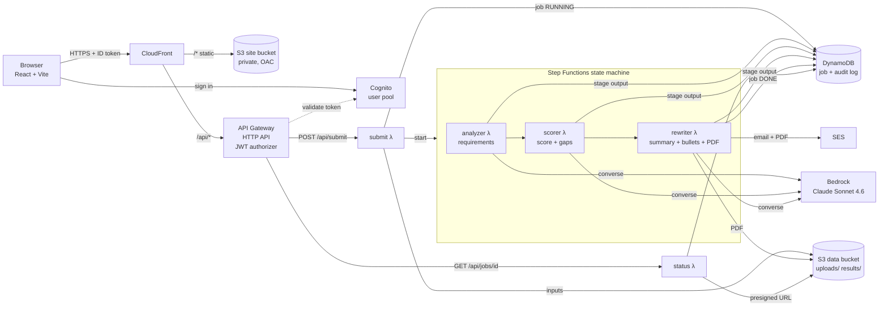

# Resume-Tailoring Pipeline

A multi-agent AWS pipeline that tailors a resume to a job description. The user gets a tailored summary and bullets, an honest gap list of requirements the resume does not meet, and a downloadable PDF. The same draft and PDF are also emailed through SES.

> **Demo.** Users sign in with an email and password (Amazon Cognito). Resumes are personal data: uploaded files and results are deleted from S3 after one day, and the recipient address is deleted from DynamoDB once the email has been attempted. Review the limitations below before real use.

## How it works



1. The user signs in (or creates an account and confirms the emailed code). The browser keeps the Cognito ID token in `sessionStorage` and sends it as a bearer token. API Gateway rejects any request without a valid token before a Lambda runs.
2. The page posts the resume and job description to `/api/submit`. The submit Lambda takes the user id and verified email from the token claims (never from the request body), enforces a per-user daily limit, validates length, stores both documents in S3, creates the job in DynamoDB and starts the state machine. It returns a job id immediately, so the 29 second API Gateway limit does not apply.
3. Three specialist Lambdas run in order. Each has its own system prompt, and the state object carries each stage's output to the next (`$.analysis`, `$.match`, `$.rewrite`).
4. The rewriter stores the PDF, emails the draft and gap list with the PDF attached (SES), then marks the job done. An email failure never fails the job: the page shows the reason and the download link still works. The recipient address is deleted from DynamoDB as soon as the email has been attempted.
5. The page polls `/api/jobs/{id}` every 3 seconds. When the job is done, the response contains the result, the email outcome and a fresh 15 minute presigned URL for the PDF.

CloudFront serves the React app and forwards `/api/*` to the API, so the browser stays on one origin and no CORS configuration is needed.

### The three specialists

| Stage | Reads | Produces | Focus |
|---|---|---|---|
| `analyzer` | job description | requirements, each `must_have` or `nice_to_have` | extract only what the posting states |
| `scorer` | resume + requirements | matches with quoted evidence, gaps with reasons, score 0-100 | judge only on evidence in the resume |
| `rewriter` | resume + matches + gaps | tailored summary + bullets, PDF | reword existing facts; never invent |

The score is computed in code, not by the model: `must_have` counts double, and a "match" only counts if its evidence quote exists in the resume.

## Honesty guardrail

The rewriter must never fabricate experience, skills or credentials. The prompt is only the first of four layers:

1. **Prompt rules.** Gaps are passed to the rewriter as "do not mention or imply".
2. **Source quotes.** Every bullet must cite a `source_quote`. Bullets whose quote is not found in the original resume are dropped (`guardrails.quote_in_source`).
3. **Number check.** A bullet or summary containing a number that is not in the resume is dropped (`guardrails.numbers_supported`).
4. **Verifier pass.** A separate model call fact-checks the surviving draft against the resume and flags unsupported bullets, which are removed.

If nothing honest survives, the job fails with a clear message instead of returning invented content. Unmet requirements always appear in the gap list.

## Reliability (Day-4 patterns)

| Pattern | Where |
|---|---|
| Max iterations | `llm.converse_json` repairs bad JSON at most `MAX_AGENT_ITERATIONS` (3) times. The rewriter's generate-and-verify loop has the same cap. |
| Error recovery | Step Functions `Retry` (backoff + jitter) on `ThrottledError`, `ModelOutputError` and Lambda service errors. `Catch` marks the job `FAILED`. A missing document raises `InputError` with a user-facing message. |
| Guardrails | Input: 50 to 15,000 characters per document, checked in the submit Lambda and again in the analyzer. Access: JWT required on every route, jobs are only readable by their owner, 5 jobs per user per day. Output: secret-like strings (AWS keys, tokens, private keys, JWTs) are redacted from results and from audit entries. |
| Audit log | Every stage writes its output to DynamoDB (`jobId`, `AUDIT#<timestamp>#<stage>`). |

## Tech stack

| Layer | Choice |
|---|---|
| Frontend | React 19, Vite, TypeScript, Vitest, oxlint |
| Backend | Python 3.12 Lambdas, boto3, reportlab (PDF) |
| Orchestration | AWS Step Functions (Standard) |
| LLM | Amazon Bedrock `converse()`, `us.anthropic.claude-sonnet-4-6`, us-east-1 (IAM role, no API key) |
| Auth | Amazon Cognito user pool (email + password, emailed verification code), API Gateway JWT authorizer |
| API | API Gateway HTTP API, throttled (submit: 1 req/s, burst 3), 5 jobs per user per day |
| Email | Amazon SES (`SendEmail` with a raw MIME message, PDF attached), IAM limited to one sender address |
| Storage | S3 (private, encrypted, 1 day expiry), DynamoDB (on demand, TTL, PITR) |
| Hosting | S3 + CloudFront (Origin Access Control, security headers, CSP) |
| IaC | AWS CDK v2 (TypeScript) |
| CI | GitHub Actions: ruff + pytest, lint + typecheck + vitest + build, tsc + jest + `cdk synth` |

## Repository layout

```
infra/       CDK app: data, functions, pipeline, api, frontend constructs + jest tests
lambdas/     src/{common,analyzer,scorer,rewriter,submit,status}, tests/, layer/requirements.txt
frontend/    React + Vite app
.github/     CI workflow, Dependabot
```

## Deploy

Prerequisites: Node 22+, Python 3 with pip, AWS CLI with credentials for the target account.

1. **Enable Bedrock access to Anthropic Claude Sonnet 4.6** in us-east-1. First-time Anthropic users must submit the use-case form once (Bedrock console, Model catalog, Anthropic). Until then every call fails with `Operation not allowed`. Check with:
   ```bash
   aws bedrock get-foundation-model-availability --region us-east-1 --model-id anthropic.claude-sonnet-4-6
   ```
   `authorizationStatus` must be `AUTHORIZED`.
2. **Verify SES addresses** in us-east-1. New accounts are in SES sandbox mode, so both the sender and every recipient (each user's account email) must be verified:
   ```bash
   aws sesv2 create-email-identity --region us-east-1 --email-identity you@example.com
   ```
   Open the verification link SES emails to that address. Repeat for each address you will test with. To email any signed-up user without verifying them one by one, request SES production access in the console. That is now reasonably safe, because mail only goes to an address the user proved they own at sign-up, and only to themselves.
3. **Bootstrap CDK** once per account and region:
   ```bash
   cd infra && npm ci
   npx cdk bootstrap aws://<ACCOUNT_ID>/us-east-1
   ```
4. **Build the frontend**:
   ```bash
   cd frontend && npm ci && npm run build
   ```
5. **Deploy everything** (data, Lambdas, state machine, API, CloudFront), passing your verified sender:
   ```bash
   cd infra && npx cdk deploy -c senderEmail=you@example.com
   ```
   The `SiteUrl` output is the app. Open it, create an account, enter the code Cognito emails you, then sign in. Use an address you verified in SES. The Lambda dependency layer is built locally with `pip` (Linux wheels), or with Docker if pip is unavailable.

### Troubleshooting: `TimeoutError ... did not establish a connection within 10000 ms`

On some networks the local DNS resolver stalls on IPv6 (AAAA) lookups, so Node takes about 15 seconds to resolve AWS hostnames and the CDK asset upload times out. The AWS CLI and curl are not affected. Force Node to request IPv4 addresses for the deploy only:

```bash
cat > /tmp/ipv4-dns.cjs <<'JS'
const dns = require('node:dns'); const orig = dns.lookup;
dns.lookup = (h, o, cb) => { if (typeof o === 'function') { cb = o; o = {}; } else if (typeof o === 'number') { o = { family: o }; } else { o = { ...(o || {}) }; }
  if (!o.family) o.family = 4; return orig.call(dns, h, o, cb); };
JS
NODE_OPTIONS="--require /tmp/ipv4-dns.cjs" npx cdk deploy -c senderEmail=you@example.com
```

### Resource names

Resources are prefixed `chakri_ResumeTailor_` (for example `chakri_ResumeTailor_Analyzer`, `chakri_ResumeTailor_Jobs`, `chakri_ResumeTailor_Pipeline`, `chakri_ResumeTailor_Users`). AWS does not allow underscores in CloudFormation stack names or S3 bucket names, so those use `chakri-ResumeTailor` and `chakri-resumetailor-{data,site}-<account>-<region>`. Helper resources that CDK creates internally (the S3 auto-delete provider and its role) keep generated names. Everything is tagged `project=chakri_ResumeTailor`. Explicit names mean a rename needs a destroy and redeploy.

### Clean up

```bash
cd infra && npx cdk destroy -c senderEmail=you@example.com
```
Buckets are emptied and the table is deleted. This stack is configured for a demo (`RemovalPolicy.DESTROY`).

### Export the audit log for a job

```bash
aws dynamodb query --region us-east-1 --table-name <JobsTableName output> \
  --key-condition-expression "jobId = :j AND begins_with(sk, :a)" \
  --expression-attribute-values '{":j":{"S":"<jobId>"},":a":{"S":"AUDIT#"}}' > audit-export.json
```

## Local development and tests

```bash
# Lambdas
cd lambdas && python3 -m venv .venv && .venv/bin/pip install -r requirements-dev.txt
.venv/bin/ruff check . && .venv/bin/pytest

# Frontend. For `npm run dev` against a deployed stack: copy public/config.example.json to
# public/config.json (UserPoolId and UserPoolClientId from the stack outputs) and set VITE_API_PROXY to ApiUrl.
cd frontend && npm ci && npm run lint && npm run typecheck && npm test && npm run dev

# Infra
cd infra && npm ci && npm test && npx cdk synth -c senderEmail=you@example.com
```

Unit tests never call AWS. A test fixture blocks DynamoDB, S3 and Bedrock clients.

## Security notes and known limitations

- Self sign-up is open: anyone can create an account. The per-user daily limit (5 jobs) and API throttling cap Bedrock cost, but many accounts multiply it. Add an AWS Budgets alarm, and consider invite-only sign-up (disable `selfSignUpEnabled`) or a WAF rate rule.
- Cognito's default email sender is limited to about 50 messages a day. Configure Cognito to send through SES for more.
- The password goes to Cognito over TLS (`USER_PASSWORD_AUTH`). Tokens are kept in `sessionStorage`, so they are cleared when the tab closes, and the CSP limits script injection. MFA and password reset are not implemented.
- The email recipient is always the verified address on the signed-in account. The request body cannot choose it.
- The API Gateway endpoint is also reachable directly, not only through CloudFront.
- CloudFront uses its default certificate, which fixes the minimum TLS version at TLSv1. Use a custom domain and ACM certificate to enforce TLS 1.2.
- Input is pasted text or a `.txt`/`.md` file read in the browser. PDF and DOCX parsing is not implemented.
- Documents are sent to Bedrock. Prompts treat them as data, but prompt injection cannot be ruled out entirely. The deterministic checks above limit the impact on the honesty rule.
- Step Functions logging records errors only, without execution data, because state contains resume excerpts.

## Spec exit check

| Item | Status |
|---|---|
| Three specialist Lambdas with focused prompts | `lambdas/src/{analyzer,scorer,rewriter}`, prompts in `common/prompts.py` |
| Step Functions chain with Retry/Catch | `infra/lib/constructs/pipeline.ts`, asserted in `infra/test/stack.test.ts` |
| Four Day-4 reliability patterns | see Reliability above |
| Honesty guardrail | see above, tested in `lambdas/tests/test_rewriter.py` |
| One-command deploy | `cdk deploy` |
| Bedrock `converse()`, no API key | `common/llm.py` |
| Login, submit, poll, render, email | React app + status Lambda render the result and PDF link. `mailer.py` sends the email with the PDF attached. |
| Screenshot and audit log from a real run | to capture after the first deploy |
