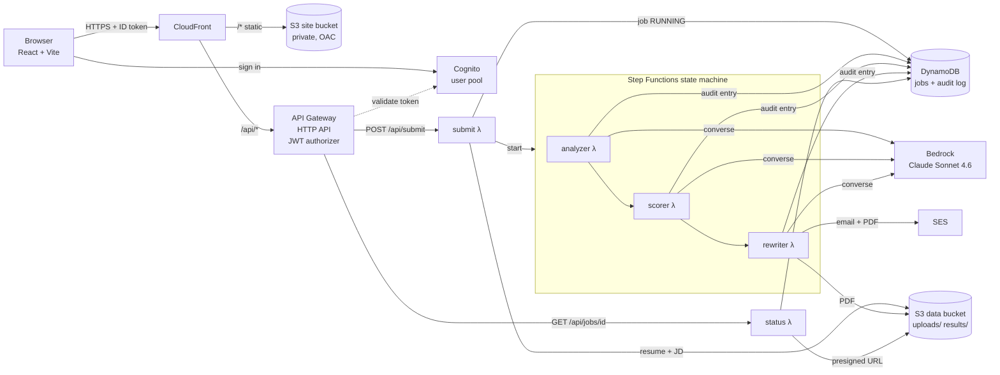
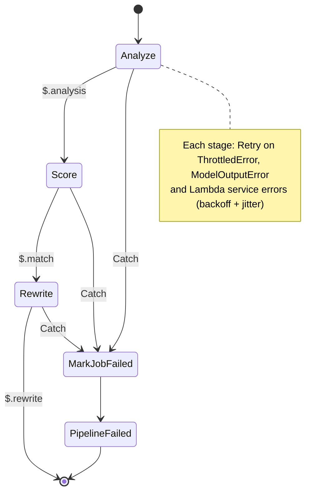
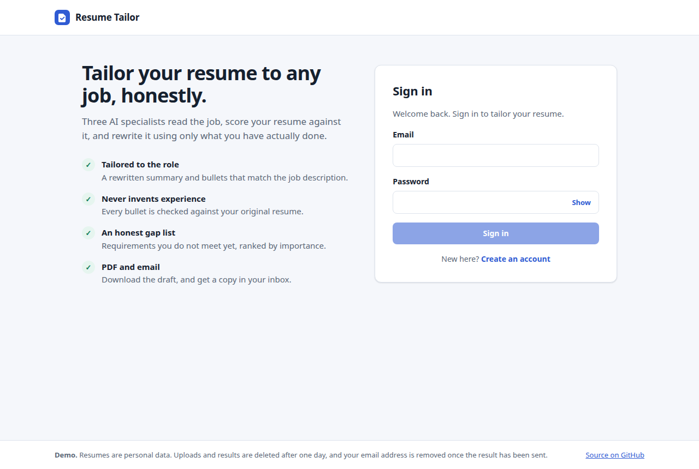
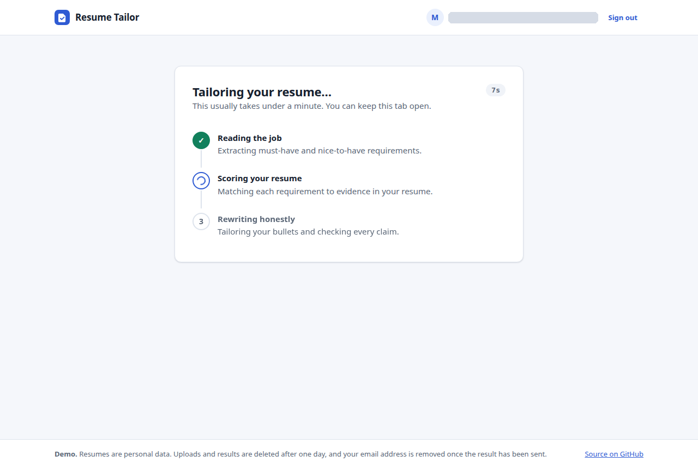

# Resume Tailor

[](https://github.com/Chakravardhan-04/resume-tailor/actions/workflows/ci.yml)

A multi-agent AWS pipeline that tailors a resume to a job description. Three specialist Lambdas, chained by Step Functions and powered by Claude on Amazon Bedrock, return:

- a tailored summary and bullet points, written **only from facts in the original resume**
- an honest **gap list** of requirements the resume does not meet yet
- a **PDF** to download, and the same draft **emailed** through Amazon SES

**Live demo:** https://d3a7a5yx4axqt.cloudfront.net (sign-up required, demo use only)


## Contents

1. [Architecture](#architecture)
2. [How the pipeline works](#how-the-pipeline-works)
3. [Agents and tools](#agents-and-tools)
4. [Honesty guardrail](#honesty-guardrail)
5. [Reliability and security](#reliability-and-security)
6. [Tech stack](#tech-stack)
7. [Repository layout](#repository-layout)
8. [Setup (local development)](#setup-local-development)
9. [Deploy to AWS](#deploy-to-aws)
10. [Demo](#demo)
11. [Audit log: all 3 stages](#audit-log-all-3-stages)
12. [GitHub](#github)
13. [Known limitations](#known-limitations)
14. [Design questions](#design-questions)
15. [Spec and score sheet mapping](#spec-and-score-sheet-mapping)

## Architecture



CloudFront serves the React app and forwards `/api/*` to the API, so the browser stays on one origin and no CORS configuration is needed.

### State machine



## How the pipeline works

1. **Sign in.** The user creates an account with email and password, confirms the emailed code, and signs in. The browser keeps the Cognito ID token in `sessionStorage`.
2. **Submit.** The page posts the resume and job description to `POST /api/submit`. API Gateway rejects requests without a valid token. The submit Lambda takes the user id and verified email from the token claims (never from the request body), enforces 5 jobs per user per day, validates both documents, stores them in S3, creates the job in DynamoDB, starts the state machine with `{jobId, inputs: {resume_key, job_key}}`, and returns a job id immediately. This avoids the 29 second API Gateway timeout.
3. **Three specialists** run in order. The state object is the pipeline's memory: each stage's output is carried forward at `$.analysis`, `$.match` and `$.rewrite`.

   | Stage | Tools it uses | Reads from state | Writes to state |
   |---|---|---|---|
   | `analyzer` | `read_inputs`, `extract_requirements` | `inputs` | `$.analysis` = requirements |
   | `scorer` | `read_inputs`, `score_match` | `inputs`, `$.analysis` | `$.match` = score, matched, gaps |
   | `rewriter` | `read_inputs`, rewrite + verify agents | `inputs`, `$.match` | `$.rewrite` = result, PDF key, email status |
4. **Deliver.** The rewriter stores the PDF, emails the draft and gap list with the PDF attached, deletes the stored recipient address, and marks the job done. An email failure never fails the job.
5. **Poll.** The page calls `GET /api/jobs/{id}` every 3 seconds. When the job is done, it renders the result, the email outcome and a fresh 15 minute presigned PDF link. Users can only read their own jobs.

## Agents and tools

### The bounded agent loop

Every specialist runs the same loop ([`common/agent.py`](lambdas/src/common/agent.py)) on Bedrock tool use:

1. Claude gets the stage's system prompt and the documents, plus one **answer tool** whose JSON Schema describes the result (`submit_requirements`, `submit_judgement`, `submit_draft`, `submit_verdict`). `toolChoice` forces it to answer through that tool.
2. Code validates the call. A rejected call goes back to the model as an error `toolResult` that says exactly what is wrong.
3. The loop **stops** on the first accepted answer, or raises `ModelOutputError` after `MAX_AGENT_ITERATIONS` (3) turns. Step Functions then retries the stage, and finally marks the job failed.

From the demo run ([`docs/demo/agent-loop-log.txt`](docs/demo/agent-loop-log.txt)), the scorer's first answer quoted the resume inexactly, was sent back, and was corrected on turn 2:

```
agent=analyzer stop=answer_accepted turns=1
agent=scorer turn=1/3 rejected: evidence for ['R3'] is not copied verbatim from the resume. Copy one exact sentence ...
agent=scorer stop=answer_accepted turns=2
agent=rewriter stop=answer_accepted turns=1
agent=verifier stop=answer_accepted turns=1
rewrite attempt=1 kept=5 dropped=1 summary_ok=True
```

### Specialist prompts

Each specialist has its own focused system prompt in [`common/prompts.py`](lambdas/src/common/prompts.py):

| Prompt | Role | Key rules |
|---|---|---|
| `ANALYZER` | requirements analyst | only requirements the posting states; classify must have / nice to have |
| `SCORER` | strict resume screener | evidence must be a verbatim quote; no quote means not met |
| `REWRITER` | resume editor | only facts in the resume; never mention gaps; no new numbers, outcomes or seniority |
| `VERIFIER` | fact-checker | flag anything the resume does not support; when in doubt, flag it |

All prompts mark the documents as untrusted data, not instructions.

### Tools

Defined in [`common/tools.py`](lambdas/src/common/tools.py). Each tool has a name, a description and a JSON Schema, and checks its arguments before running. Missing or empty input raises `InputError`, which fails the job with a user-facing message (it is not retried).

| Tool | Kind | Input schema | Returns | On missing input |
|---|---|---|---|---|
| `read_inputs` | S3 read | `resume_key: string`, `job_key: string` (both required, must be under `uploads/`) | `{resume_text, job_text}`, both length-checked (50 to 15,000 characters) | "The job description is missing for this job. Please submit both a resume and a job description." |
| `extract_requirements` | LLM-driven | `job_text: string` | `{requirements: [{id, text, category, type}]}`, ids `R1..Rn` assigned in code | "extract_requirements: required input 'job_text' is missing or empty." |
| `score_match` | LLM-driven | `resume_text: string`, `requirements: array` | `{score, matched: [{id, requirement, category, evidence}], gaps: [{id, requirement, category, reason}]}` | "score_match: required input 'requirements' is missing or empty." |

**Paste vs upload.** The form accepts pasted text or a `.txt` / `.md` file (read in the browser). Either way the submit API stores both documents at `uploads/<jobId>/resume.txt` and `uploads/<jobId>/job.txt`, and the state machine passes those keys to `read_inputs`. There is one input path into the pipeline.

**Scoring.** `score_match` computes the score in code: `must_have` counts 2, `nice_to_have` counts 1, and a match only counts if its evidence is really in the resume. Non-verbatim evidence is first sent back to the model; anything that still does not match becomes a gap.

## Honesty guardrail

The rewriter must never fabricate experience, skills or credentials. The prompt is only the first layer; layers 2 to 5 are code, so they hold even if the model ignores its instructions.

| # | Layer | Code |
|---|---|---|
| 1 | Prompt rules: gaps are passed as "do not mention or imply"; no new numbers, outcomes, scope or skill-level claims | `common/prompts.py` |
| 2 | Every bullet must cite a `source_quote` that exists verbatim in the resume | `guardrails.quote_in_source` |
| 3 | A bullet or summary is rejected if it contains a number, a claim word ("production", "led", "expert", "improving", ...) or a **gap term** ("Kubernetes", "Terraform", ...) that the resume does not contain | `guardrails.numbers_supported`, `unsupported_claims`, `gap_terms` |
| 4 | A separate verifier agent fact-checks the surviving draft and flags unsupported bullets | `rewriter.verify` |
| 5 | Fail closed: with no honest bullet the job fails with a clear message. If only the summary keeps failing, it is replaced by verbatim resume sentences that matched the job | `rewriter.tailor` |

Rejected words are fed back to the model ("In the summary, remove: production, track record"). Unmet requirements always appear in the gap list.

**Tested.** The acceptance test `test_jd_demanding_an_absent_skill_puts_it_in_gaps_never_in_bullets` ([`tests/test_rewriter.py`](lambdas/tests/test_rewriter.py)) gives the rewriter a job that wants Kubernetes and a model that keeps writing Kubernetes into bullets and the summary. Kubernetes stays in the gap list and appears nowhere in the output. In the live demo the job asks for Terraform/CDK, Kubernetes, Docker, SQS/EventBridge and an AWS certification, none of which the resume has. All of them are in the gap list and none in the draft ([`docs/demo/honesty-check.json`](docs/demo/honesty-check.json)):

```json
"gapTerms": ["Architect", "CDK", "Certified", "Docker", "EventBridge", "Infrastructure", "Kubernetes", "SQS", "Solutions", "Terraform"],
"gapTermsFoundInDraft": [],
"unsupportedClaimWordsInDraft": []
```

## Reliability and security

| Pattern | Implementation |
|---|---|
| Max iterations | Every agent loop stops after `MAX_AGENT_ITERATIONS` (3) turns and raises `ModelOutputError`. The rewriter's generate, filter and verify loop has the same cap. |
| Error recovery | Step Functions `Retry` with backoff and jitter on `ThrottledError`, `ModelOutputError` and Lambda service errors. `Catch` marks the job `FAILED`, keeping the clearest message. A missing document raises `InputError` with a user-facing message. |
| Input guardrails | 50 to 15,000 characters per document, checked in the browser, the submit Lambda and the analyzer. Documents are wrapped as untrusted data in every prompt. |
| Output guardrails | AWS keys, tokens, private keys and JWTs are redacted from results, emails and audit entries. |
| Audit log | Every stage writes its output to DynamoDB under `jobId` + `AUDIT#<timestamp>#<stage>`. |
| Access control | Cognito JWT on every route, job ownership check, 5 jobs per user per day, API throttling (submit: 1 req/s, burst 3). |
| Least privilege | One IAM role per Lambda. Only the three stages can call Bedrock. Only the rewriter can send email, and only from the configured sender. |
| Privacy | S3 objects expire after 1 day, DynamoDB records after 30 days. The recipient address is deleted after sending. Step Functions logs errors only, without execution data. |
| Web security | Private S3 behind CloudFront (OAC), HTTPS only, CSP, HSTS, `X-Frame-Options: DENY`, no third-party scripts or fonts. |

### Forced-failure demo

[`scripts/demo-reliability.sh`](scripts/demo-reliability.sh) runs against the deployed stack with your AWS CLI credentials:

```bash
AWS_PROFILE=<profile> scripts/demo-reliability.sh docs/demo
```

1. **Missing input.** It uploads only the resume and starts the pipeline. `read_inputs` raises `InputError`, the Analyze `Catch` fires, and the job is marked failed with a clear message.
2. **Length cap.** It sends a 15,001-character resume to the submit Lambda, which returns 400 and stores nothing.

Output from the real run ([`docs/demo/reliability-demo.json`](docs/demo/reliability-demo.json)):

```json
"statesEntered": ["Analyze", "MarkJobFailed", "PipelineFailed"],
"stageError": {"error": "InputError", "message": "The job description is missing for this job. Please submit both a resume and a job description."},
"job": {"status": "FAILED", "stage": "analyzer", "errorCode": "InputError", "errorMessage": "The job description is missing for this job. ..."},
"lengthCap": {"statusCode": 400, "body": {"error": "The resume is too long (maximum 15000 characters)."}}
```

The page shows that message to the user. Max-iteration escalation is covered by `test_loop_is_bounded_and_escalates` in [`tests/test_agent.py`](lambdas/tests/test_agent.py).

## Tech stack

| Layer | Choice |
|---|---|
| Frontend | React 19, Vite, TypeScript, plain CSS with design tokens (light and dark), Vitest + Testing Library, oxlint |
| Backend | Python 3.12 Lambdas, boto3, reportlab (PDF), ruff, pytest |
| Orchestration | AWS Step Functions (Standard) |
| LLM | Amazon Bedrock `converse()`, `us.anthropic.claude-sonnet-4-6`, us-east-1, IAM role only (no API key) |
| Auth | Amazon Cognito user pool, API Gateway JWT authorizer |
| API | API Gateway HTTP API |
| Email | Amazon SES v2 (raw MIME with PDF attachment) |
| Storage | S3 (private, encrypted), DynamoDB (on demand, TTL, PITR) |
| Hosting | S3 + CloudFront |
| IaC | AWS CDK v2 (TypeScript) with jest assertions |
| CI | GitHub Actions, Dependabot |

## Repository layout

```
.
├── frontend/                 React app
│   └── src/
│       ├── auth/             Cognito client, auth context and provider
│       ├── components/       layout (header, footer) and ui (button, alert, spinner, ...)
│       ├── features/
│       │   ├── auth/         sign-in, sign-up, email confirmation
│       │   └── tailor/       input form, progress, result view, score ring
│       ├── hooks/            usePollJob
│       └── styles/           design tokens and styles
├── lambdas/
│   ├── src/
│   │   ├── common/           agent (bounded loop), tools, guardrails, prompts, llm, storage, jobs, mailer, pdf, http, stage
│   │   ├── analyzer/  scorer/  rewriter/     Step Functions stages
│   │   └── submit/  status/                  API handlers
│   ├── tests/                pytest suite (no AWS calls)
│   └── layer/requirements.txt
├── infra/                    CDK app
│   ├── lib/constructs/       data, auth, functions, pipeline, api, frontend
│   └── test/                 template assertions
├── scripts/                  demo-reliability.sh (forced failure + length cap)
├── docs/demo/                screenshots, inputs, result, PDF, audit log, agent log, reliability and honesty evidence
└── .github/                  CI workflow, Dependabot
```

## Setup (local development)

Prerequisites: Node 22+, Python 3.12+ with pip, and (for deploying) the AWS CLI.

```bash
git clone https://github.com/Chakravardhan-04/resume-tailor.git
cd resume-tailor
```

**Lambdas**

```bash
cd lambdas
python3 -m venv .venv
.venv/bin/pip install -r requirements-dev.txt
.venv/bin/ruff check . && .venv/bin/ruff format --check . && .venv/bin/pytest
```

**Frontend**

```bash
cd frontend
npm ci
npm run lint && npm run typecheck && npm test && npm run build
```

To run the UI locally against a deployed stack:

```bash
cp public/config.example.json public/config.json      # fill in UserPoolId and UserPoolClientId from the stack outputs
VITE_API_PROXY=https://<api-id>.execute-api.us-east-1.amazonaws.com npm run dev
```

**Infra**

```bash
cd infra
npm ci
npm test
npx cdk synth -c senderEmail=you@example.com     # needs frontend/dist (run the frontend build first)
```

Unit tests never call AWS: a pytest fixture blocks the DynamoDB, S3, SES and Bedrock clients.

## Deploy to AWS

1. **Enable Claude Sonnet 4.6 in Bedrock** (us-east-1). First-time Anthropic users must submit the use-case form once (Bedrock console, Model catalog, Anthropic). Check:
   ```bash
   aws bedrock get-foundation-model-availability --region us-east-1 --model-id anthropic.claude-sonnet-4-6
   ```
   `authorizationStatus` must be `AUTHORIZED`.
2. **Verify the SES sender**, then click the link SES emails you:
   ```bash
   aws sesv2 create-email-identity --region us-east-1 --email-identity you@example.com
   ```
   In SES sandbox mode, recipients must be verified too. Users only ever receive mail at their own verified account address, so requesting SES production access is safe once you need it.
3. **Bootstrap CDK** once per account and region:
   ```bash
   cd infra && npm ci
   npx cdk bootstrap aws://<ACCOUNT_ID>/us-east-1
   ```
4. **Build the frontend**:
   ```bash
   cd frontend && npm ci && npm run build
   ```
5. **Deploy** (one command for the whole stack):
   ```bash
   cd infra && npx cdk deploy -c senderEmail=you@example.com
   ```
   Use `--profile <name>` or `AWS_PROFILE` to pick the account.

| Output | Use |
|---|---|
| `SiteUrl` | the app |
| `ApiUrl` | API Gateway endpoint (for local dev proxy) |
| `UserPoolId`, `UserPoolClientId` | local `config.json` |
| `JobsTableName` | audit log export |
| `StateMachineArn`, `DataBucketName` | debugging |

6. **First use:** open `SiteUrl`, choose **Create an account**, enter the emailed code, sign in, and click **Try a sample**.

**Updating:** rebuild the frontend if it changed, then run the same `cdk deploy`.

**Clean up:**
```bash
cd infra && npx cdk destroy -c senderEmail=you@example.com
```
Buckets are emptied, and the table and user pool are deleted (`RemovalPolicy.DESTROY`, demo setting). The CDK bootstrap stack is left in place.

### Resource names

Resources are prefixed `chakri_ResumeTailor_`, for example `chakri_ResumeTailor_Analyzer`, `chakri_ResumeTailor_Jobs`, `chakri_ResumeTailor_Pipeline`, `chakri_ResumeTailor_Users`. AWS does not allow underscores in CloudFormation stack names or S3 bucket names, so those are `chakri-ResumeTailor` and `chakri-resumetailor-{data,site}-<account>-<region>`. Two internal CDK helpers keep generated names. Everything is tagged `project=chakri_ResumeTailor`.

### Troubleshooting

**`TimeoutError ... did not establish a connection within 10000 ms` during deploy.** Some networks stall on IPv6 (AAAA) DNS lookups, so Node needs about 15 seconds per AWS hostname. Force IPv4 lookups for the deploy only:

```bash
cat > /tmp/ipv4-dns.cjs <<'JS'
const dns = require('node:dns'); const orig = dns.lookup;
dns.lookup = (h, o, cb) => { if (typeof o === 'function') { cb = o; o = {}; } else if (typeof o === 'number') { o = { family: o }; } else { o = { ...(o || {}) }; }
  if (!o.family) o.family = 4; return orig.call(dns, h, o, cb); };
JS
NODE_OPTIONS="--require /tmp/ipv4-dns.cjs" npx cdk deploy -c senderEmail=you@example.com
```

**Every job fails with `Operation not allowed`.** Bedrock access to Anthropic models is not enabled (deploy step 1).

**"Email not sent" on the result page.** The sender or recipient is not verified in SES, or the account is in sandbox mode. The PDF download still works.

## Demo

A real run on the deployed stack, using the fictional sample from **Try a sample**. Inputs and outputs are in [`docs/demo/`](docs/demo). The account email is redacted in the screenshots.

| Step | Screenshot |
|---|---|
| 1. Sign in or create an account |  |
| 2. Paste or upload the resume and job description |  |
| 3. Watch the three stages run |  |
| 4. Score, tailored draft, gap list, evidence, PDF and email confirmation |  |

Mobile layout: [`05-result-mobile.png`](docs/demo/screenshots/05-result-mobile.png). Files from the run:

- [`resume.txt`](docs/demo/resume.txt) and [`job-description.txt`](docs/demo/job-description.txt): inputs
- [`result.json`](docs/demo/result.json): the status API response (email status `SENT`)
- [`tailored-resume.pdf`](docs/demo/tailored-resume.pdf): the generated PDF, also attached to the email
- [`audit-log.json`](docs/demo/audit-log.json): the audit log described below
- [`agent-loop-log.txt`](docs/demo/agent-loop-log.txt): CloudWatch lines showing each agent loop and the guardrail
- [`honesty-check.json`](docs/demo/honesty-check.json) and [`reliability-demo.json`](docs/demo/reliability-demo.json): guardrail and forced-failure evidence

Outcome: score **67/100**, 5 of 9 requirements matched, 5 tailored bullets, 4 gaps (Terraform/CDK is the missing must-have, because the resume only mentions AWS SAM). The email arrived with the PDF attached. The whole pipeline took about 16 seconds.

## Audit log: all 3 stages

Each stage writes its full output to the jobs table. The demo job `f859bfa1-81eb-44e1-89fa-372b3e952629` has one entry per stage:

| Sort key | Stage | Recorded output |
|---|---|---|
| `AUDIT#2026-11-24T17:13:41.464+00:00#analyzer` | analyzer | 9 requirements (6 must have, 3 nice to have) |
| `AUDIT#2026-11-24T17:13:47.370+00:00#scorer` | scorer | score 67, 5 matches with evidence, 4 gaps with reasons |
| `AUDIT#2026-11-24T17:13:54.122+00:00#rewriter` | rewriter | final summary, bullets and gaps, PDF key, `emailStatus: SENT` |

Excerpts from [`docs/demo/audit-log.json`](docs/demo/audit-log.json):

```jsonc
// analyzer
{"requirements": [
  {"id": "R1", "text": "3+ years of professional experience in backend development", "category": "must_have", "type": "experience"},
  {"id": "R2", "text": "Strong Python skills", "category": "must_have", "type": "skill"},
  // ... 9 in total
]}

// scorer
{"score": 67,
 "matched": [{"id": "R1", "requirement": "3+ years of professional experience in backend development", "category": "must_have",
              "evidence": "Backend-focused software engineer with 3 years of experience building Python services and REST APIs on AWS."}],
 "gaps":    [{"id": "R5", "requirement": "Infrastructure as code with Terraform or AWS CDK", "category": "must_have",
              "reason": "No mention of Terraform or AWS CDK; AWS SAM is cited but is not Terraform or CDK."}]}

// rewriter
{"resultKey": "results/f859bfa1-81eb-44e1-89fa-372b3e952629.pdf",
 "emailStatus": "SENT",
 "result": {"score": 67, "summary": "Backend-focused software engineer with 3 years of experience ...",
            "bullets": ["Built REST APIs in Python and Flask for an order management system, serving 40,000 requests per day.", "..."],
            "gaps": ["..."], "matched": ["..."]}}
```

The CloudWatch log for the same job shows the rewriter guardrail: `attempt=1 kept=5 dropped=1 summary_ok=True` (one unsupported bullet removed).

Export the audit log for any job:

```bash
aws dynamodb query --region us-east-1 --table-name chakri_ResumeTailor_Jobs \
  --key-condition-expression "jobId = :j AND begins_with(sk, :a)" \
  --expression-attribute-values '{":j":{"S":"<jobId>"},":a":{"S":"AUDIT#"}}' > audit-export.json
```

## GitHub

Repository: https://github.com/Chakravardhan-04/resume-tailor

**CI** ([`.github/workflows/ci.yml`](.github/workflows/ci.yml)) runs on every push to `main` and on every pull request:

| Job | Checks |
|---|---|
| Lambdas | `ruff check`, `ruff format --check`, `pytest` |
| Frontend | `oxlint`, `tsc`, `vitest`, `vite build` (uploads `dist` for the next job) |
| Infra | `tsc`, `jest` template assertions, `cdk synth` (no AWS credentials needed) |

**Dependabot** opens weekly update PRs for npm (frontend, infra), pip (Lambda layer) and GitHub Actions. Merge them only when CI is green, and check major versions by hand (for example, ts-jest does not support TypeScript 7 yet).

**Conventions.** Commits follow [Conventional Commits](https://www.conventionalcommits.org/) (`feat:`, `fix:`, `refactor:`, `docs:`, `ci:`, `chore:`). Work on a branch, open a pull request, and merge when CI passes. No secrets are stored in the repo: the app uses IAM roles, and the frontend config holds only public Cognito identifiers.

## Known limitations

- Self sign-up is open. Daily limits and throttling cap Bedrock cost per user, but not the number of accounts. Add an AWS Budgets alarm, and consider invite-only sign-up or AWS WAF.
- Password reset and MFA are not implemented. Cognito's default email sender allows about 50 verification emails per day; configure Cognito to use SES for more.
- Input is plain text or a `.txt` / `.md` file read in the browser. PDF and DOCX parsing, and the stretch option of presigned S3 upload with an S3 event trigger, are not implemented.
- The API Gateway endpoint can also be called directly (still authenticated). CloudFront uses its default certificate, so the minimum TLS version is fixed at TLSv1 until a custom domain and ACM certificate are added.
- Prompt injection inside a document cannot be ruled out entirely. The deterministic checks limit what it can do to the output.

## Design questions

**Why a pipeline of specialists, not one agent?** Each step has a different job and a different failure mode. Separate prompts stay short and strict, each output is checked in code before the next stage sees it, each stage is retried on its own, and the audit log shows exactly which stage produced what. One agent would mix extraction, judging and writing in one context, which makes it more likely to "find" evidence for the rewrite it wants to produce.

**How does state pass between stages?** Step Functions carries one JSON object: `{jobId, inputs}` from submit, then `$.analysis`, `$.match` and `$.rewrite` added by each stage (`resultPath`). The documents themselves stay in S3; the state holds their keys.

**How does the poller read status?** Each stage writes `stage` to the job's `META` item in DynamoDB. The status Lambda reads that item (only for the job's owner) and returns status, stage, the result and a fresh presigned PDF link. The page calls it every 3 seconds.

**Bedrock auth.** No API key exists anywhere. The three stage Lambdas call Bedrock with their IAM roles, which allow `bedrock:InvokeModel` on the `us.anthropic.claude-sonnet-4-6` inference profile only. The submit and status Lambdas have no Bedrock permission at all.

**Hardest part.** Honesty. The model kept adding small embellishments ("production-grade", "track record", "at scale") that a prompt alone did not stop. The fix was deterministic checks, specific feedback, and a verbatim fallback for the summary.

**What is simplified.** The demo resume is fictional; files are text only; there is no password reset or MFA. The claim-word list in `guardrails.py` is hand-written and can miss new phrasings, which is why the verifier agent exists as a second check.

**What breaks under load.** Bedrock tokens-per-minute quotas are the first limit: each job makes about 4 to 6 model calls. Throttling becomes `ThrottledError`, which Step Functions retries with backoff, but sustained overload will fail jobs. Next come Lambda account concurrency and SES sending limits (200 per day in sandbox). API throttling (submit 1 req/s, burst 3) and the 5 jobs per user per day cap protect the stack today. To scale: request higher Bedrock quotas, queue submissions (SQS in front of Step Functions), and move SES out of sandbox.

## Spec and score sheet mapping

| Requirement | Where |
|---|---|
| Three specialist Lambdas, each with its own focused system prompt | `lambdas/src/{analyzer,scorer,rewriter}`, [Specialist prompts](#specialist-prompts) |
| Each stage a real bounded loop that stops correctly | [The bounded agent loop](#the-bounded-agent-loop), `tests/test_agent.py`, `docs/demo/agent-loop-log.txt` |
| Tools `read_inputs`, `extract_requirements`, `score_match` with descriptions and schemas | [Tools](#tools), `common/tools.py`, `tests/test_tools.py` |
| Step Functions chains analyze → score → rewrite with Retry/Catch | `infra/lib/constructs/pipeline.ts`, asserted in `infra/test/stack.test.ts` |
| Max iterations · Retry/Catch · input/output guardrails · audit log | [Reliability and security](#reliability-and-security) |
| Forced failure (Catch fires, missing input escalates) | [Forced-failure demo](#forced-failure-demo), `docs/demo/reliability-demo.json` |
| Honesty guardrail, tested | [Honesty guardrail](#honesty-guardrail), `docs/demo/honesty-check.json` |
| `cdk deploy` stands up the whole stack, incl. state machine | [Deploy to AWS](#deploy-to-aws) |
| Claude via Bedrock `converse()`, IAM role, no API key | `common/llm.py`, [Design questions](#design-questions) |
| Submit → poll → draft + gap list render; email arrives | [Demo](#demo) (`result.json`: email `SENT`) |
| README: diagram, setup, deploy steps, demo, audit log all 3 stages, GitHub | this file |
| Screenshot of a tailored draft + gap list | `docs/demo/screenshots/04-result.png` |
| Audit log from one real run (all three stages) | [`docs/demo/audit-log.json`](docs/demo/audit-log.json) |
| Stretch: Step Functions pipeline, async status poller, S3 static hosting | implemented (S3 site bucket behind CloudFront) |
| Stretch: presigned S3 upload + S3 event | not implemented |

**Differences from the spec.** Sign-in (Cognito) was added, so the result is emailed to the account's verified address instead of an email typed into the form; this also stops the form from being used to email strangers. There is a fifth Lambda (`submit`) that starts the state machine. The site is served from S3 through CloudFront rather than S3 website hosting, so the bucket stays private.
