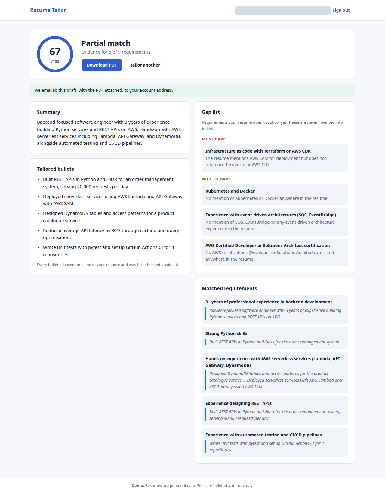
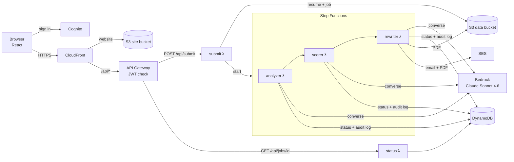
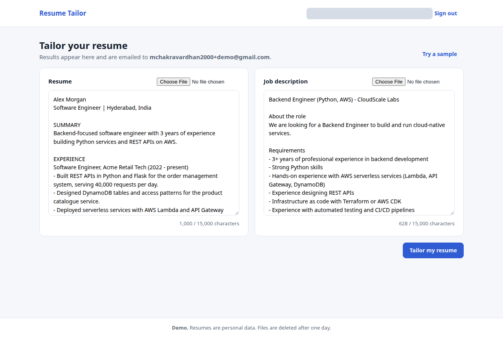

# Resume Tailor

[](https://github.com/Chakravardhan-04/resume-tailor/actions/workflows/ci.yml)

A multi-agent pipeline on AWS. You sign in, paste a resume and a job description, and three AI specialists (Claude on Amazon Bedrock, chained by Step Functions) return:

- a tailored summary and bullets, written **only from facts in your resume**
- an honest **gap list** of requirements the resume does not meet
- a **PDF**, shown on the page and **emailed** to you through SES

Live demo: https://d3a7a5yx4axqt.cloudfront.net (demo only)



## Architecture



| Step | What happens | Code |
|---|---|---|
| 1. Submit | Check the login token and both documents' length, save them to S3, start the state machine, return a job id at once (the pipeline takes longer than API Gateway's 29 s limit) | `lambdas/src/submit/handler.py` |
| 2. Analyze | Agent extracts the job's requirements (must have / nice to have) | `lambdas/src/analyzer/handler.py` |
| 3. Score | Agent finds a word-for-word resume quote for each requirement; no quote means it is a gap. The score is computed in code | `lambdas/src/scorer/handler.py` |
| 4. Rewrite | Agent rewrites the summary and bullets, the honesty guardrail removes anything unsupported, then PDF + email | `lambdas/src/rewriter/handler.py` |
| 5. Poll | The page calls the status API every 3 s and shows the result | `lambdas/src/status/handler.py`, `frontend/src/JobView.tsx` |

**State passing.** The Step Functions state is the pipeline's memory. It starts as `{jobId, inputs: {resume_key, job_key}}`, and each stage adds its output at `$.analysis`, `$.match` and `$.rewrite`.

### The agent loop

Every specialist uses the same small loop, in [`lambdas/src/common/agent.py`](lambdas/src/common/agent.py):

1. Send Claude the system prompt and the documents, with one **answer tool** whose JSON schema describes the result. `toolChoice` forces Claude to answer through it.
2. Check the answer in code.
3. If it's valid, **stop**. If it's invalid, send the error back to Claude and loop. After 3 turns, raise `ModelOutputError`, and Step Functions retries the stage.

The tools are `read_inputs`, `extract_requirements` and `score_match`, in [`lambdas/src/common/tools.py`](lambdas/src/common/tools.py). The system prompts are in [`lambdas/src/common/prompts.py`](lambdas/src/common/prompts.py), one per specialist.

### Guardrails and reliability

| Pattern | How | Code |
|---|---|---|
| Max iterations | Each agent loop stops after 3 turns; the rewriter retries at most 3 times | `agent.py`, `rewriter/handler.py` |
| Retry / Catch | Retry with backoff on `ThrottledError` and `ModelOutputError`; any other error is caught, the job is marked `FAILED` | `infra/lib/constructs/pipeline.ts` |
| Missing input | `read_inputs` raises `InputError` with a clear message, so the job fails without a retry | `tools.py` |
| Input guardrail | Each document is 50 to 15,000 characters | `guardrails.py` |
| Output guardrail | AWS keys, tokens, private keys and JWTs are redacted | `guardrails.py` |
| Audit log | Every stage's output is saved in DynamoDB under the job id | `stage.py` |
| Honesty | Each bullet must quote a real resume line. Claim words ("production", "expert"), gap skills ("Kubernetes") and invented numbers are removed. A verifier agent fact-checks the rest. If nothing honest is left, the job fails | `rewriter/handler.py`, `guardrails.py` |

## Project layout

```
lambdas/src/
  submit/  status/            API handlers
  analyzer/  scorer/  rewriter/   the three Step Functions stages
  common/
    agent.py       the bounded agent loop
    tools.py       read_inputs, extract_requirements, score_match
    prompts.py     one system prompt per agent
    guardrails.py  length caps, secret redaction, honesty checks
    stage.py       progress + audit log + clear failures for each stage
    aws.py         S3, DynamoDB, Bedrock, SES and PDF helpers
    errors.py      the error types Step Functions retries or catches
lambdas/tests/     pytest (no AWS calls)
frontend/src/      React: AuthForm, TailorForm, JobView, api.ts, auth.ts
infra/lib/         CDK: data, auth, functions, pipeline, api, frontend
scripts/demo-reliability.sh   forced-failure + length-cap demo
docs/demo/         screenshots and files from a real run
```

## Setup

You need Node 22 and Python 3.12.

```bash
git clone https://github.com/Chakravardhan-04/resume-tailor.git
cd resume-tailor

# Lambdas
cd lambdas && python3 -m venv .venv && .venv/bin/pip install -r requirements-dev.txt
.venv/bin/ruff check . && .venv/bin/pytest

# Frontend
cd ../frontend && npm ci && npm test && npm run build

# Infra
cd ../infra && npm ci && npm test
```

## Deploy

1. **Bedrock access.** In the Bedrock console (us-east-1), enable Anthropic Claude Sonnet 4.6. First-time Anthropic users submit a short form.
2. **SES sender.** Verify the address you will send from. In sandbox mode, recipients must be verified too:
   ```bash
   aws sesv2 create-email-identity --region us-east-1 --email-identity you@example.com
   ```
3. **Deploy** (bootstrap is needed only once per account and region):
   ```bash
   cd frontend && npm run build
   cd ../infra && npx cdk bootstrap
   npx cdk deploy -c senderEmail=you@example.com
   ```
   The `SiteUrl` output is the app. Open it, create an account, enter the emailed code, and sign in.

Resources are named `chakri_ResumeTailor_*`. The stack and buckets use `chakri-ResumeTailor` and `chakri-resumetailor-*`, because AWS does not allow underscores in those names. To remove everything, run `npx cdk destroy -c senderEmail=you@example.com`.

**Deploy times out (`did not establish a connection within 10000 ms`)?** Some networks stall on IPv6 DNS lookups. Save this as `/tmp/ipv4-dns.cjs`:

```js
const dns = require('node:dns'); const orig = dns.lookup;
dns.lookup = (h, o, cb) => { if (typeof o === 'function') { cb = o; o = {}; } else if (typeof o === 'number') { o = { family: o }; } else { o = { ...(o || {}) }; }
  if (!o.family) o.family = 4; return orig.call(dns, h, o, cb); };
```

Then deploy with `NODE_OPTIONS="--require /tmp/ipv4-dns.cjs" npx cdk deploy -c senderEmail=you@example.com`.

## Demo

A real run on the deployed stack, using **Try a sample** (a fictional resume). All files are in [`docs/demo/`](docs/demo).

| | |
|---|---|
| 1. Sign in |  |
| 2. Paste or upload both documents |  |
| 3. The three stages run |  |
| 4. Score, draft, gap list, PDF, email sent |  |

Result: score **67/100**, 5 of 9 requirements matched, 5 bullets, and 4 gaps (Terraform/CDK, Kubernetes/Docker, SQS/EventBridge, AWS certification). None of the gap skills appear in the draft. The email arrived with the PDF attached. The whole run took about 12 seconds. Files: [`result.json`](docs/demo/result.json), [`tailored-resume.pdf`](docs/demo/tailored-resume.pdf).

**Agent loops in the logs** ([`agent-loop-log.txt`](docs/demo/agent-loop-log.txt)). On the first attempt, the summary was rejected by the honesty check and sent back. The second attempt passed:

```
agent=analyzer stop=answer_accepted turns=1
agent=scorer stop=answer_accepted turns=1
agent=rewriter stop=answer_accepted turns=1
agent=verifier stop=answer_accepted turns=1
rewrite attempt=1 kept=5 dropped=0 summary_ok=False
agent=rewriter stop=answer_accepted turns=1
agent=verifier stop=answer_accepted turns=1
rewrite attempt=2 kept=5 dropped=0 summary_ok=True
```

**Forced failure and length cap.** Run `AWS_PROFILE=<profile> scripts/demo-reliability.sh`:

```
== 1. Forced failure: upload ONLY the resume, then start the pipeline
States the execution went through:
Analyze  MarkJobFailed  PipelineFailed
Job record (what the page shows the user):
{ "status": "FAILED", "stage": "analyzer", "errorCode": "InputError",
  "errorMessage": "The job description is missing for this job. Please submit both a resume and a job description." }

== 2. Length cap: 15,001-character resume
{"statusCode": 400, ... "The resume is too long (maximum 15000 characters)."}
```

The honesty guardrail is also tested in `lambdas/tests/test_rewriter.py`. In that test the job wants Kubernetes and the model keeps adding it, but Kubernetes ends up only in the gap list.

## Audit log: all 3 stages

Each stage saves its output to the `chakri_ResumeTailor_Jobs` table. The demo job `0113af1f-2580-4bd0-8842-42c81a3359c1` has one entry per stage. The full log is in [`docs/demo/audit-log.json`](docs/demo/audit-log.json).

| Sort key | Stage | Output |
|---|---|---|
| `AUDIT#2026-11-24T18:03:10.103+00:00#analyzer` | analyzer | 9 requirements (6 must have, 3 nice to have) |
| `AUDIT#2026-11-24T18:03:12.838+00:00#scorer` | scorer | score 67, 5 matches with resume quotes, 4 gaps with reasons |
| `AUDIT#2026-11-24T18:03:20.093+00:00#rewriter` | rewriter | final draft and gaps, PDF key, `emailStatus: SENT` |

```jsonc
// analyzer
{"requirements": [{"id": "R1", "text": "3+ years of professional experience in backend development", "category": "must_have"}, ...]}
// scorer
{"score": 67,
 "matched": [{"id": "R1", "evidence": "Backend-focused software engineer with 3 years of experience building Python services and REST APIs on AWS.", ...}],
 "gaps":    [{"id": "R5", "requirement": "Infrastructure as code with Terraform or AWS CDK",
              "reason": "The resume mentions AWS SAM for deployment but does not reference Terraform or AWS CDK.", ...}]}
// rewriter
{"resultKey": "results/0113af1f-2580-4bd0-8842-42c81a3359c1.pdf", "emailStatus": "SENT", "result": {"summary": "...", "bullets": [...], "gaps": [...]}}
```

Export the audit log for any job:

```bash
aws dynamodb query --region us-east-1 --table-name chakri_ResumeTailor_Jobs \
  --key-condition-expression "jobId = :j AND begins_with(sk, :a)" \
  --expression-attribute-values '{":j":{"S":"<jobId>"},":a":{"S":"AUDIT#"}}'
```

## GitHub

Repository: https://github.com/Chakravardhan-04/resume-tailor

[CI](.github/workflows/ci.yml) runs on every push and pull request: ruff and pytest for the Lambdas, lint, tests and build for the frontend, and jest plus `cdk synth` for the infra. No secrets are in the repo. Lambdas use IAM roles (no API keys), and the frontend config holds only public Cognito ids.
