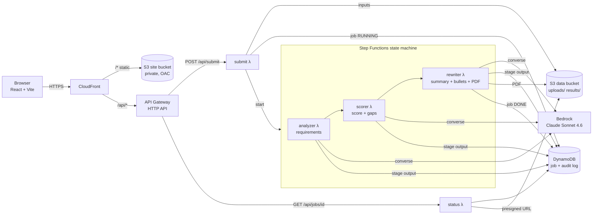

# Resume-Tailoring Pipeline

A multi-agent AWS pipeline that tailors a resume to a job description. The user gets a tailored summary and bullets, an honest gap list of requirements the resume does not meet, and a downloadable PDF.

> **Demo only.** Resumes contain personal data and the app is unauthenticated. Do not submit real resumes until authentication is added. Uploaded files and results are deleted from S3 after one day.

## How it works



1. The page posts the resume and job description to `/api/submit`. The submit Lambda validates length, stores both documents in S3, creates the job in DynamoDB and starts the state machine. It returns a job id immediately, so the 29 second API Gateway limit does not apply.
2. Three specialist Lambdas run in order. Each has its own system prompt, and the state object carries each stage's output to the next (`$.analysis`, `$.match`, `$.rewrite`).
3. The page polls `/api/jobs/{id}` every 3 seconds. When the job is done, the response contains the result and a fresh 15 minute presigned URL for the PDF.

CloudFront serves the React app and forwards `/api/*` to the API, so the browser stays on one origin and no CORS configuration is needed.

### The three specialists

| Stage | Reads | Produces | Focus |
|---|---|---|---|
| `analyzer` | job description | requirements, each `must_have` or `nice_to_have` | extract only what the posting states |
| `scorer` | resume + requirements | matches with quoted evidence, gaps with reasons, score 0-100 | judge only on evidence in the resume |
| `rewriter` | resume + matches + gaps | tailored summary + bullets, PDF | reword existing facts; never invent |

The score is computed in code, not by the model: `must_have` counts double, and a "match" only counts if its evidence quote exists in the resume.

## Honesty guardrail

The rewriter must never fabricate experience, skills or credentials. The prompt is only the first of four layers:

1. **Prompt rules.** Gaps are passed to the rewriter as "do not mention or imply".
2. **Source quotes.** Every bullet must cite a `source_quote`. Bullets whose quote is not found in the original resume are dropped (`guardrails.quote_in_source`).
3. **Number check.** A bullet or summary containing a number that is not in the resume is dropped (`guardrails.numbers_supported`).
4. **Verifier pass.** A separate model call fact-checks the surviving draft against the resume and flags unsupported bullets, which are removed.

If nothing honest survives, the job fails with a clear message instead of returning invented content. Unmet requirements always appear in the gap list.

## Reliability (Day-4 patterns)

| Pattern | Where |
|---|---|
| Max iterations | `llm.converse_json` repairs bad JSON at most `MAX_AGENT_ITERATIONS` (3) times. The rewriter's generate-and-verify loop has the same cap. |
| Error recovery | Step Functions `Retry` (backoff + jitter) on `ThrottledError`, `ModelOutputError` and Lambda service errors. `Catch` marks the job `FAILED`. A missing document raises `InputError` with a user-facing message. |
| Guardrails | Input: 50 to 15,000 characters per document, checked in the submit Lambda and again in the analyzer. Output: secret-like strings (AWS keys, tokens, private keys, JWTs) are redacted from results and from audit entries. |
| Audit log | Every stage writes its output to DynamoDB (`jobId`, `AUDIT#<timestamp>#<stage>`). |

## Tech stack

| Layer | Choice |
|---|---|
| Frontend | React 19, Vite, TypeScript, Vitest, oxlint |
| Backend | Python 3.12 Lambdas, boto3, reportlab (PDF) |
| Orchestration | AWS Step Functions (Standard) |
| LLM | Amazon Bedrock `converse()`, `us.anthropic.claude-sonnet-4-6`, us-east-1 (IAM role, no API key) |
| API | API Gateway HTTP API, throttled (submit: 1 req/s, burst 3) |
| Storage | S3 (private, encrypted, 1 day expiry), DynamoDB (on demand, TTL, PITR) |
| Hosting | S3 + CloudFront (Origin Access Control, security headers, CSP) |
| IaC | AWS CDK v2 (TypeScript) |
| CI | GitHub Actions: ruff + pytest, lint + typecheck + vitest + build, tsc + jest + `cdk synth` |

## Repository layout

```
infra/       CDK app: data, functions, pipeline, api, frontend constructs + jest tests
lambdas/     src/{common,analyzer,scorer,rewriter,submit,status}, tests/, layer/requirements.txt
frontend/    React + Vite app
.github/     CI workflow, Dependabot
```

## Deploy

Prerequisites: Node 22+, Python 3 with pip, AWS CLI with credentials for the target account.

1. **Enable Bedrock model access** for Anthropic Claude Sonnet 4.6 in us-east-1 (Bedrock console, Model access). Calls fail without it.
2. **Bootstrap CDK** once per account and region:
   ```bash
   cd infra && npm ci
   npx cdk bootstrap aws://<ACCOUNT_ID>/us-east-1
   ```
3. **Build the frontend**:
   ```bash
   cd frontend && npm ci && npm run build
   ```
4. **Deploy everything** (data, Lambdas, state machine, API, CloudFront):
   ```bash
   cd infra && npx cdk deploy
   ```
   The `SiteUrl` output is the app. The Lambda dependency layer is built locally with `pip` (Linux wheels), or with Docker if pip is unavailable.

### Clean up

```bash
cd infra && npx cdk destroy
```
Buckets are emptied and the table is deleted. This stack is configured for a demo (`RemovalPolicy.DESTROY`).

### Export the audit log for a job

```bash
aws dynamodb query --region us-east-1 --table-name <JobsTableName output> \
  --key-condition-expression "jobId = :j AND begins_with(sk, :a)" \
  --expression-attribute-values '{":j":{"S":"<jobId>"},":a":{"S":"AUDIT#"}}' > audit-export.json
```

## Local development and tests

```bash
# Lambdas
cd lambdas && python3 -m venv .venv && .venv/bin/pip install -r requirements-dev.txt
.venv/bin/ruff check . && .venv/bin/pytest

# Frontend (set VITE_API_PROXY to a deployed ApiUrl to use a real backend)
cd frontend && npm ci && npm run lint && npm run typecheck && npm test && npm run dev

# Infra
cd infra && npm ci && npm test && npx cdk synth
```

Unit tests never call AWS. A test fixture blocks DynamoDB, S3 and Bedrock clients.

## Security notes and known limitations

- No authentication. Anyone with the URL can submit jobs, so the API is throttled to limit Bedrock cost. Add Cognito or a WAF rate rule before real use.
- The API Gateway endpoint is also reachable directly, not only through CloudFront.
- CloudFront uses its default certificate, which fixes the minimum TLS version at TLSv1. Use a custom domain and ACM certificate to enforce TLS 1.2.
- Input is pasted text or a `.txt`/`.md` file read in the browser. PDF and DOCX parsing is not implemented.
- Documents are sent to Bedrock. Prompts treat them as data, but prompt injection cannot be ruled out entirely. The deterministic checks above limit the impact on the honesty rule.
- Step Functions logging records errors only, without execution data, because state contains resume excerpts.

## Spec exit check

| Item | Status |
|---|---|
| Three specialist Lambdas with focused prompts | `lambdas/src/{analyzer,scorer,rewriter}`, prompts in `common/prompts.py` |
| Step Functions chain with Retry/Catch | `infra/lib/constructs/pipeline.ts`, asserted in `infra/test/stack.test.ts` |
| Four Day-4 reliability patterns | see Reliability above |
| Honesty guardrail | see above, tested in `lambdas/tests/test_rewriter.py` |
| One-command deploy | `cdk deploy` |
| Bedrock `converse()`, no API key | `common/llm.py` |
| Submit, poll, render, download | React app + status Lambda. Result is a PDF link, not email (SES was dropped by request). |
| Screenshot and audit log from a real run | to capture after the first deploy |
